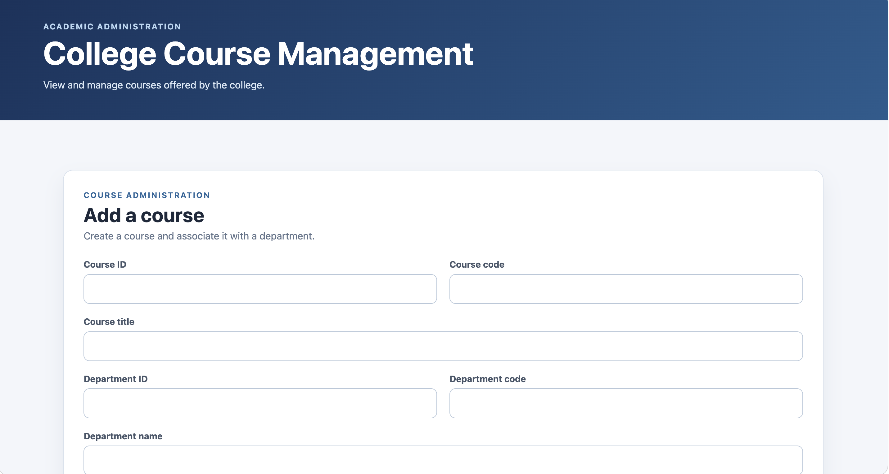
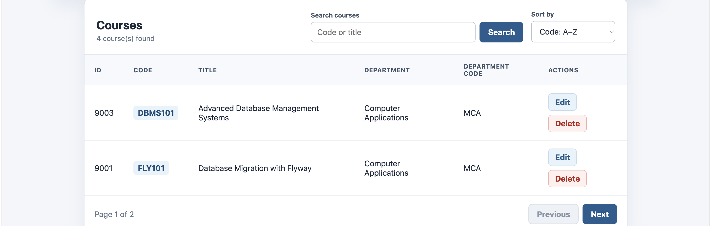

# College Course Management

[](https://github.com/prabakar-durai/college-course-management/actions/workflows/maven-ci.yml)

A full-stack course administration application built with React, Spring Boot and PostgreSQL. It demonstrates layered backend design, REST API development, database migrations, validation, automated testing, continuous integration and containerized deployment.

## Application Preview

### Course creation



### Course management



## Features

- Create, retrieve, update and delete courses
- Associate every course with a department
- Search by partial course code or title without case sensitivity
- Sort and navigate paginated course results
- Validate requests and display field-level errors
- Reject duplicate course codes and report missing courses
- Confirm course deletion before sending the request
- Display loading, empty, success and API error states
- Persist development data in H2 and production data in PostgreSQL
- Manage the PostgreSQL schema through versioned Flyway migrations
- Run the complete application with Docker Compose
- Verify backend and frontend behaviour through automated tests and CI

## Technology Stack

### Backend

- Java 21
- Spring Boot 4.1.2
- Spring Web MVC
- Spring Data JPA and Hibernate
- Jakarta Bean Validation
- Flyway
- Maven
- JUnit, Mockito and MockMvc

### Frontend

- React 19
- Vite
- JavaScript, HTML and CSS
- Vitest and React Testing Library
- Oxlint and Prettier
- Nginx

### Data and delivery

- H2 for development and automated tests
- PostgreSQL 17 for the production profile
- Docker and Docker Compose
- GitHub Actions

## Architecture

```text
Browser
   |
   | HTTP
   v
React application served by Nginx
   |
   | /api requests
   v
Spring Boot REST controller
   v
Service layer
   v
CourseRepository abstraction
   v
JPA repository adapter
   v
Spring Data JPA / Hibernate
   v
H2 or PostgreSQL
```

The service layer depends on the `CourseRepository` abstraction instead of Spring Data directly. A JPA adapter implements the abstraction and isolates persistence concerns from the business logic.

When Docker Compose is used, Nginx serves the React production build and proxies `/api` requests to the Spring Boot container. Spring Boot connects to PostgreSQL, while Flyway manages the database schema.

## REST API

| Method | Endpoint | Description |
| --- | --- | --- |
| `GET` | `/api/courses` | Search and retrieve courses with pagination and sorting |
| `GET` | `/api/courses/{code}` | Retrieve a course by code |
| `POST` | `/api/courses` | Create a course |
| `PUT` | `/api/courses/{code}` | Update a course |
| `DELETE` | `/api/courses/{code}` | Delete a course |

The collection endpoint accepts these optional parameters:

| Parameter | Default | Description |
| --- | --- | --- |
| `query` | None | Partial case-insensitive match against code or title |
| `page` | `0` | Zero-based page number |
| `size` | `10` | Maximum results in one page |
| `sort` | `code,asc` | Property and direction used to sort results |

Example:

```bash
curl "http://localhost:8080/api/courses?query=java&page=0&size=10&sort=title,asc"
```

Example course request:

```json
{
  "id": 101,
  "code": "JAVA101",
  "title": "Java Programming",
  "departmentId": 1,
  "departmentName": "Computer Applications",
  "departmentCode": "MCA"
}
```

The API uses standard response statuses including `200`, `201`, `204`, `400`, `404` and `409`.

## Quick Start with Docker

### Requirements

- Docker Desktop
- Docker Compose

Copy the environment template:

```bash
cp .env.example .env
```

Set a local PostgreSQL password in `.env`, then build and start the complete stack:

```bash
docker compose up --build -d
```

Check the containers:

```bash
docker compose ps
```

Open the application:

- React UI: [http://localhost:3000](http://localhost:3000)
- REST API: [http://localhost:8080/api/courses](http://localhost:8080/api/courses)

View logs:

```bash
docker compose logs -f application frontend
```

Stop the containers while preserving PostgreSQL data:

```bash
docker compose down
```

To also delete the local PostgreSQL volume:

```bash
docker compose down -v
```

> `docker compose down -v` permanently removes the locally stored PostgreSQL data.

## Local Development

### Backend

Run `CollegeApplication` from IntelliJ IDEA with the `dev` profile:

```text
--spring.profiles.active=dev
```

The backend starts at `http://localhost:8080`.

Development tools:

- Swagger UI: [http://localhost:8080/swagger-ui/index.html](http://localhost:8080/swagger-ui/index.html)
- H2 Console: [http://localhost:8080/h2-console](http://localhost:8080/h2-console)

### Frontend

With the backend running, start the Vite development server:

```bash
cd frontend
npm install
npm run dev
```

Open [http://localhost:5173](http://localhost:5173). Vite proxies `/api` requests to the backend at port `8080`.

## Environment Profiles

| Profile | Database | Purpose |
| --- | --- | --- |
| `dev` | Persistent file-based H2 | Local development, Swagger and H2 console |
| `test` | In-memory H2 | Isolated automated tests |
| `prod` | PostgreSQL | Docker and production-style configuration |

The production profile reads database settings from environment variables. `.env.example` documents the required values, while the local `.env` file is excluded from Git.

Flyway migration scripts are stored in `src/main/resources/db/migration`. Flyway changes the production schema, and Hibernate validates that the schema matches the JPA mappings.

## Testing and Code Quality

### Backend

Run:

```bash
mvn test
```

The backend suite contains **44 tests** covering domain logic, repositories, services, REST controllers, validation, exception handling, JPA persistence, integration, search, pagination and sorting.

### Frontend

From the `frontend` directory, run:

```bash
npm test
npm run lint
npm run build
npm run format:check
```

The focused frontend suite contains **5 tests across 2 test files**, covering course creation, validation responses, paginated course display and API failures.

## Continuous Integration

GitHub Actions runs on pushes and pull requests. Independent jobs verify both parts of the application:

- The backend job installs Java 21 and runs `mvn --batch-mode verify`.
- The frontend job installs Node.js dependencies, runs tests and linting, creates a production build and verifies formatting.

## Project Structure

```text
college-course-management/
├── .github/workflows/       # GitHub Actions workflow
├── docs/images/             # Portfolio screenshots
├── frontend/                # React application and Nginx configuration
│   ├── src/components/      # Course creation and editing components
│   ├── src/test/            # Frontend test setup
│   ├── Dockerfile
│   └── nginx.conf
├── src/main/java/           # Spring Boot application
│   └── com/prabakar/collegecourse/
│       ├── controller/
│       ├── domain/
│       ├── dto/
│       ├── exception/
│       ├── repository/
│       └── service/
├── src/main/resources/      # Profiles and Flyway migrations
├── src/test/                # Backend automated tests
├── compose.yml              # Full-stack container orchestration
├── Dockerfile               # Spring Boot image
├── pom.xml
└── README.md
```

## Key Design Decisions

- Layered backend architecture keeps HTTP, business and persistence concerns separate.
- Repository abstraction prevents the service layer from depending directly on Spring Data.
- DTOs separate API requests and responses from persistence entities.
- Centralized exception handling produces consistent HTTP error responses.
- Environment-specific profiles isolate development, test and production configuration.
- Flyway owns production schema evolution; Hibernate validates the result.
- Nginx serves optimized frontend assets and proxies API requests inside Docker Compose.
- PostgreSQL data is retained in a Docker named volume across container restarts.

## Purpose

This portfolio project was developed incrementally to refresh and demonstrate modern Java, Spring Boot and React development. It brings together clean architecture, REST API design, frontend integration, persistence, migrations, testing, continuous integration and Docker-based delivery in one complete application.

## Author

Prabakar Duraisamy
